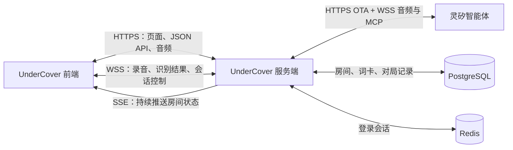
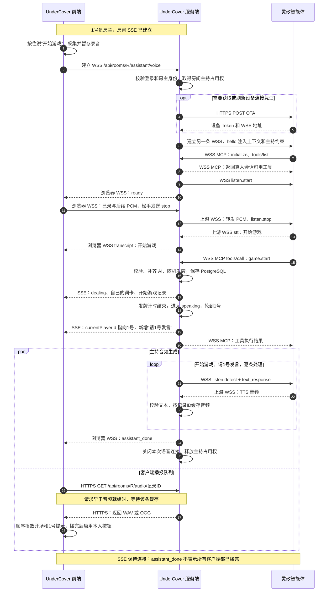
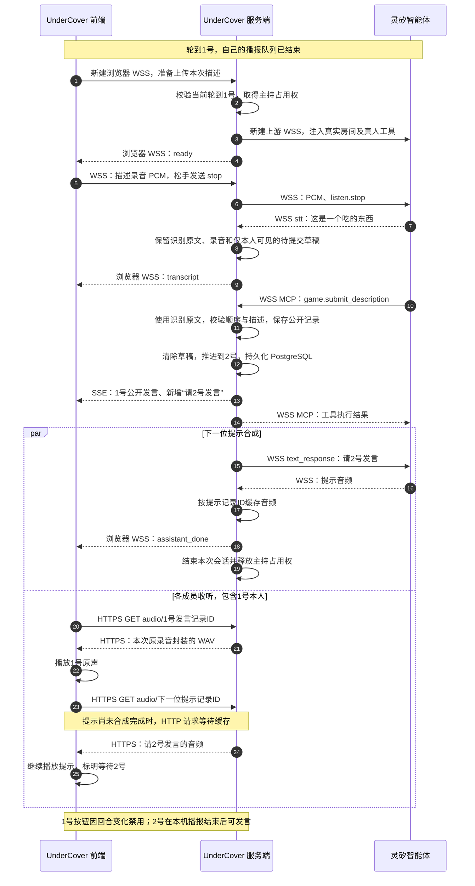
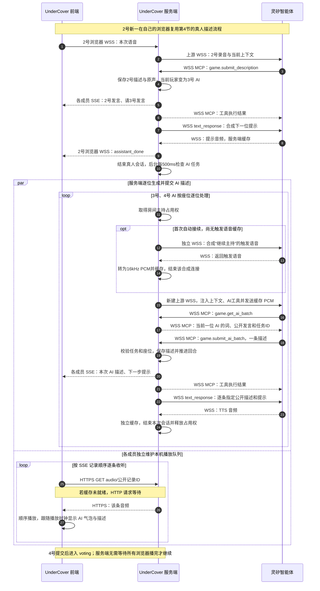
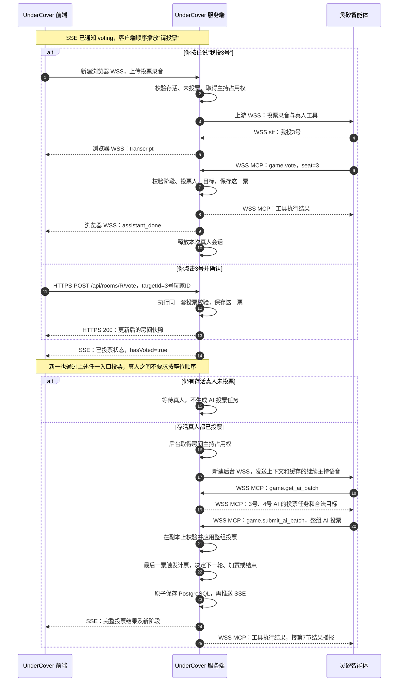
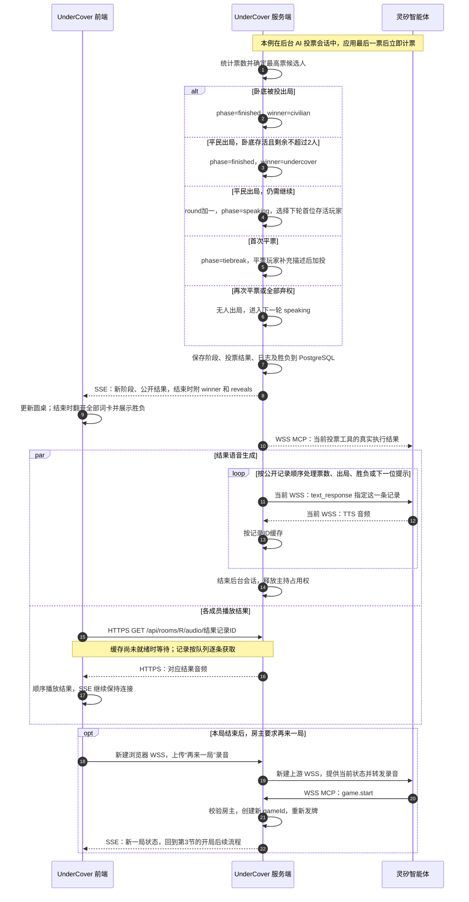

# UnderCover 完整游戏交互与架构

本文按当前代码的完整灵矽语音模式，说明一局游戏从入座、语音开局、轮流描述、投票到结束时，UnderCover 前端、UnderCover 服务端和灵矽智能体之间的调用链路。

以下以四人局为例：**1号是你，也是房主；2号是新一，是真人；3号、4号是 AI。** 示例房间 ID 使用 `R`，玩家 ID 和记录 ID 均为说明用的占位符。HTTPS / WSS 对应公开访问环境，本机开发可使用 HTTP / WS。

**UnderCover 前端通过应用域名访问 UnderCover 服务端；服务端再连接灵矽。录音与会话控制走 WebSocket，房间变化走 SSE，当前公开播报由客户端通过 HTTP 获取音频。** 如果入口有 Ingress 或反向代理，它负责把这些请求转发到同一个 UnderCover 服务端。

## 1. 先分清整局使用的连接



[可编辑图源](diagrams/connections.mmd)

| 谁连接谁 | 协议与路径 | 用途 | 持续时间 |
| --- | --- | --- | --- |
| UnderCover 前端 → UnderCover 服务端 | HTTPS，页面和 `/api/...` | 加载界面，查询、创建和加入房间；文字描述、点击投票 | 普通请求，用完返回 |
| UnderCover 服务端 → UnderCover 前端 | SSE，`GET /api/rooms/R/events` | 推送阶段、当前玩家、自己的词卡、公开记录等个性化快照 | 入座后保持，贯穿整局 |
| UnderCover 前端 ↔ UnderCover 服务端 | WSS，`/api/rooms/R/assistant/voice` | 上传录音，接收 `ready`、`transcript`、`assistant_done` 等消息 | 每次按住说话建立一次 |
| UnderCover 前端 → UnderCover 服务端 | HTTPS，`GET /api/rooms/R/audio/记录ID` | 获取一条公开发言或主持提示的音频 | 按播放队列逐条获取 |
| UnderCover 服务端 → 灵矽 | HTTPS，默认 `POST https://xrobo.qiniuapi.com/v1/ota/` | 获取设备 Token 和连接地址，结果有短暂缓存 | 需要时请求 |
| UnderCover 服务端 ↔ 灵矽 | WSS，默认 `wss://xrobo-io.qiniuapi.com/v1/ws/` | 传输录音、识别结果、MCP 工具调用和合成音频 | 每次真人会话或后台 AI 任务使用 |

UnderCover 前端与服务端之间、服务端与灵矽之间，是两条独立的 WebSocket。服务端终止并处理这两段连接，负责身份绑定、录音保存、工具执行和音频缓存。

WebSocket 最初通过 HTTP `GET + Upgrade` 握手，升级成功后状态码为 `101`。SSE 保持 HTTP 响应，类型为 `text/event-stream`，只向客户端持续发送事件。游戏工具调用封装在服务端与灵矽的 WSS 消息中，由端侧 MCP 的 `initialize`、`tools/list` 和 `tools/call` 完成发现与调用。

PostgreSQL 保存房间、词卡、票数和对局记录；Redis 保存登录会话。原始录音、合成音频缓存、房间计时器和 SSE 订阅保留在服务端内存，当前同一个应用数据库只运行一个游戏进程。

## 2. 你进入房间：先走 HTTP，再建立 SSE

打开网页时，UnderCover 前端向服务端请求：

```text
GET /api/config       获取语音等能力是否已配置
GET /api/auth/me      获取当前用户、是否已经加入房间
GET /api/rooms        获取大厅房间列表
```

创建或加入房间时，分别调用：

```text
POST /api/rooms
POST /api/rooms/R/join
```

服务端根据登录 Cookie 找到 Redis 中的会话，再把账号绑定到房间玩家。此时确定“你是1号”；后续发言与投票使用这个已认证的身份，不依赖模型猜测是谁在说话。

入座后，UnderCover 前端通过 `EventSource` 建立：

```text
GET /api/rooms/R/events
```

服务端先返回当前视图，之后持续发送 `room` 事件。下面仅列出与流程有关的部分字段：

```json
{
  "phase": "waiting",
  "myPlayerId": "玩家1的ID",
  "isHost": true,
  "currentPlayerId": "",
  "version": 1,
  "logs": []
}
```

新一的浏览器也有自己的 SSE 连接。发牌后，你收到自己的 `myWord`，新一收到他的 `myWord`；结束前的成员视图不会包含所有人的词卡和阵营。每次状态变更增加 `version`，客户端忽略过期快照。

## 3. 你按住说“开始游戏”：走两段 WebSocket



[可编辑图源](diagrams/game-start.mmd)

按下按钮后，UnderCover 前端准备录音，并连接自己的服务端：

```text
wss://游戏域名/api/rooms/R/assistant/voice
```

服务端校验登录、房间成员身份和回合权限。等待阶段只有房主可开局；取得房间主持占用权后，`agentActive` 设为 `true`，其他人暂不能开启新的真人语音会话。

服务端使用 `LINX_DEVICE_IDS` 中已绑定的软件终端获取连接凭证，建立到灵矽的上游 WSS。通过 `hello` 注入：

| 参数 | 内容 |
| --- | --- |
| `game_context` | 真实房间快照、座位、真人与 AI 身份及当前阶段；去掉真人秘密词卡和私密草稿 |
| `game_instructions` | 主持约束、工具使用规则和本桌真实玩家名单 |

灵矽通过 MCP 发现本次会话的工具。真人会话提供查询、开局、描述、投票和跳过工具；后台 AI 工具只在自动会话中提供。

浏览器在上游连接期间先把录到的 PCM 缓存在本机，收到 `ready` 后按顺序发送已录制与后续数据。音频为16kHz、单声道 PCM16LE，通常每20ms一帧。松手时先发送最后一段录音，再发送 `{"type":"stop"}`；服务端向灵矽转发 PCM 和 `listen.stop`。

灵矽返回 `stt` 原文“开始游戏”，理解意图后，通过现有上游 WSS 发起 MCP 工具调用。例如：

```json
{
  "type": "mcp",
  "payload": {
    "jsonrpc": "2.0",
    "id": 1,
    "method": "tools/call",
    "params": {
      "name": "game.start",
      "arguments": {}
    }
  }
}
```

`game.start` 是上游 WebSocket 中的一条工具调用消息。服务端收到后执行本地规则：校验房主与阶段、补齐 AI 座位、随机分配卧底和词卡，进入 `dealing`，并保存 PostgreSQL。发牌计时约2.5秒，之后计时器推进到 `speaking`，轮到1号，新增“请1号发言。”记录。

各成员通过 SSE 收到自己的词卡和公开记录。服务端复用当前灵矽会话，以 `listen.detect` 的 `text_response` 逐条指定“开始游戏。”“请1号发言。”，校验返回文本后缓存对应音频。UnderCover 前端通过 `/audio/记录ID` 获取并顺序播放。

本次工具动作处理完毕，服务端向发起者发送 `assistant_done` 并结束这次语音会话。SSE 和本机音频队列继续工作；`assistant_done` 表示本次会话处理完成，不代表所有成员都已播放结束。

## 4. 轮到1号，你描述自己的词：再次建立语音会话



[可编辑图源](diagrams/player-description.mmd)

开局那次语音会话已经结束。当前轮到你、没有其他主持会话且本机播报队列结束后，按钮启用。假设你说“这是一个吃的东西。”，录音仍沿着同一类链路传输：

```text
你的 UnderCover 前端 → 浏览器 WSS → UnderCover 服务端 → 上游 WSS → 灵矽
```

灵矽返回识别原文后，服务端在本次连接中保存原文，并向你的 UnderCover 前端发送 `transcript`。对于描述回合，还会保存按玩家、游戏、轮次和阶段绑定的私密草稿，暂存录音，供漏提交时恢复。

灵矽理解为本人的描述后调用 `game.submit_description`。服务端根据连接身份确定是1号，优先使用本次识别原文，校验当前发言顺序、文字长度及是否直接包含自己的词；成功后保存公开描述，清除草稿，当前玩家推进为2号。

状态写入 PostgreSQL 成功后，服务端向所有成员的 SSE 推送新增记录。每个客户端都把它们排入同一个播放队列：

```text
1号的公开发言 → 请2号发言
```

这一条真人发言优先播放本次录音原声，包含1号自己的浏览器。服务端将 PCM 封装为 WAV，经 HTTP 音频接口返回；“请2号发言。”由灵矽合成。客户端先播完1号，再播放下一位提示。1号按钮因回合变化禁用，2号在自己的客户端满足条件后可发言。

正常语音路径在 MCP 工具调用时就提交。手动输入文字或确认恢复草稿时，使用 HTTP：

```http
POST /api/rooms/R/speech
Content-Type: application/json

{"text":"这是一个吃的东西。"}
```

如果识别成功但灵矽没有成功调用提交工具，私密草稿保留、对应回合暂停自动超时跳过，页面显示“已识别，待提交”。确认后执行同一套提交规则；原文未修改且录音仍在内存时，继续复用原录音。

## 5. 新一发言，以及3号、4号 AI 接续



[可编辑图源](diagrams/ai-continuation.mmd)

轮到2号新一时，他在自己的浏览器通过第4节的真人语音流程提交。你的浏览器继续接收 SSE、获取公开音频并播放；你的麦克风按钮保持等待状态。

新一提交后，当前玩家变成3号 AI。服务端后台约每500毫秒检查待处理任务，取得房间主持占用权后自动接续。这里没有新的玩家录音，也不需要客户端额外发起语音连接。

当前自动接续采用公开设备语音协议：首次由灵矽合成并缓存一段“继续主持，请处理当前的AI回合，等待真人操作。”音频，转换为16kHz PCM；随后把它作为后台会话的输入触发智能体，后续复用缓存。

灵矽在后台会话中调用 `game.get_ai_batch`。服务端返回当前一位 AI 的任务，包括该 AI 的词、公开发言、阶段和任务 ID。灵矽生成描述，通过 `game.submit_ai_batch` 提交。服务端校验任务是否过期、座位和顺序是否合法，再保存并推进回合；该 AI 描述和下一步提示随即经 SSE 广播，并由当前灵矽会话逐条合成、缓存。

完成这一位 AI 的提交与合成后，服务端结束本次会话，再调度下一位。**描述阶段一次只提交一位 AI；投票阶段可以整组提交。** 多个 AI 座位由绑定的灵矽智能体按任务扮演，并未各自创建独立智能体。

对你和新一的 UnderCover 前端而言，这期间的链路是：

```text
持续接收 SSE → 发现新增公开记录 → HTTP 获取该条音频 → 顺序播放与显示气泡
```

3号、4号描述之后，规则引擎进入 `voting`，新增“请投票。”。每个客户端按本机队列依次收听，不等待整组 AI 汇总成一段自由回复。

## 6. 所有人描述完毕：进入投票



[可编辑图源](diagrams/voting.mmd)

进入投票阶段后，SSE 快照中的 `phase` 为 `voting`，`currentPlayerId` 为空。存活且尚未投票的玩家可以投票；语音入口还要等待当前主持会话和本机播报结束。

你有两种投票方式：

| 操作 | UnderCover 前端发送什么 | 最终如何记票 |
| --- | --- | --- |
| 按住说“我投3号” | 新建 WSS，上传本次录音 | 灵矽通过上游 WSS 调用 `game.vote`，参数为 `{"seat":3}` |
| 点击3号并确认 | HTTPS `POST /api/rooms/R/vote`，发送 `{"targetId":"3号玩家ID"}` | 服务端直接执行投票规则 |

两种入口最终校验同样的条件：当前是投票阶段、本人还存活、尚未投票、目标在合法范围内。`game.vote` 的座位0或 HTTP 的空 `targetId` 表示弃权。

投票没有按1号、2号依次提交的要求。你和新一各提交自己的票；服务端将 `hasVoted` 等状态经 SSE 推送，票齐后再生成完整结果。语音投票也受同一房间只能有一个主持会话的限制。

当前实现会等所有存活真人都已投票，再向灵矽提供 AI 投票任务。在本例中，典型顺序为：

```text
你投票、新一投票（先后不限）
→ 后台取得3号、4号的 AI 投票任务
→ 灵矽通过 game.submit_ai_batch 提交整组 AI 投票
→ 服务端校验并应用
→ 最后一票触发计票
```

AI 任务包含合法目标，整组动作先在游戏副本上校验；任一动作不合法则不提交这一组。成功后原子保存新的游戏状态，并通过 SSE 通知成员。普通投票超时由服务端计时器按未投玩家弃权处理。

## 7. 计票、继续游戏或结束，由服务端规则自动推进



[可编辑图源](diagrams/settlement.mmd)

票齐后，UnderCover 服务端直接计票并决定后续阶段：

| 计票结果 | 后续阶段 |
| --- | --- |
| 卧底出局 | `finished`，平民胜利 |
| 平民出局，卧底存活且剩余人数不超过2人 | `finished`，卧底胜利 |
| 平民出局，尚未满足结束条件 | 下一轮 `speaking`，由首位存活玩家开始 |
| 首次平票 | `tiebreak`，平票玩家补充描述后加投 |
| 再次平票或全部弃权 | 无人出局，进入下一轮 |

这些阶段变化由最后一票触发，UnderCover 前端通过 SSE 接收结果。首次平票时仅候选人进入补充描述，之后所有存活玩家再投票，目标限制为平票候选人。

假设3号是卧底且被投出局，服务端新增票数和“3号……票，是卧底，平民获胜。”等记录，保存结果，并推送类似下面的视图。示例仅列出部分字段和一位玩家的揭晓信息：

```json
{
  "phase": "finished",
  "winner": "civilian",
  "reveals": [
    {
      "seat": 3,
      "role": "undercover",
      "word": "该玩家的词"
    }
  ]
}
```

`reveals` 在结束阶段才包含所有玩家的词与身份。UnderCover 前端据此翻开词卡、显示胜负，再通过 HTTP 获取票数、出局和胜负等公开记录的音频，按顺序播放。

在本例中，最后一票由后台 AI 会话提交，服务端复用该上游 WSS 返回 MCP 执行结果，并用 `text_response` 合成固定结果。如果音频缓存丢失，HTTP 音频接口会按已保存的公开文本请求灵矽重新合成，同一条记录的并发请求会合并。

结束后房间仍保留，SSE 继续连接。房主说“再来一局”会建立新的一次语音会话并调用 `game.start`，创建新的 `gameId`、重新发牌。房主关闭房间则走单独的 HTTP `DELETE /api/rooms/R`：服务端删除 PostgreSQL 记录并通知 `closed`，各客户端停止录音和播放、返回大厅。

## 8. 查看实际网络请求与连接生命周期

浏览器开发者工具的 Network 面板中，可以按下表对应观察：

| 请求 | 应该看到的行为 |
| --- | --- |
| `/api/rooms/R/events` | 一个保持连接的 SSE 请求，持续收到 `room` 事件；关闭房间时收到 `closed` |
| `/api/rooms/R/assistant/voice` | 每次按住说话出现一次 WebSocket，包含二进制录音及 `ready`、`transcript`、`assistant_done` 消息 |
| `/api/rooms/R/audio/记录ID` | 发言和主持提示按播放队列逐条请求；音频尚未就绪时请求可能保持等待 |
| `/api/rooms/R/speech` | 手动文字描述或确认恢复草稿时出现 |
| `/api/rooms/R/vote` | 点击确认投票时出现 |

服务端与灵矽之间的 OTA、上游 WebSocket 和 MCP 消息通过服务端日志观察。UnderCover 前端请求携带应用 Cookie；设备 Token 保留在服务端。

**一局游戏由持续的 SSE 加上多次短期语音会话组成。** 每次按住说话和每个后台 AI 任务使用相应会话；当前房间由 PostgreSQL 状态和每次注入的上下文续接，登录身份由 Redis 会话确定。

服务端状态推进与浏览器播放是两个时钟。服务端可能已经生成下一条 AI 描述，而你的浏览器还在播放上一条。UnderCover 前端按本机队列保证声音顺序，AI 描述、头像气泡和高亮跟随播放时钟；服务端不会等待所有成员都播完才继续。因此，不同玩家的声音并非严格同时播放，`assistant_done` 也不代表所有人听完了。

正常语音发言使用原录音回放；文字描述、AI 发言和主持提示使用灵矽合成。重启后原录音和合成缓存不会恢复，但已保存的公开文字可以重新合成。若浏览器阻止自动播放，客户端保留队列等待用户开启声音；灵矽音频获取失败时，会尝试浏览器语音并明确显示来源。

## 代码入口

| 位置 | 对应职责 |
| --- | --- |
| [App.vue](../web/src/App.vue) | 页面初始化、入座与 SSE 订阅、文字和点击操作、圆桌展示 |
| [usePushToTalk.ts](../web/src/composables/usePushToTalk.ts) | 录音缓存、浏览器 WebSocket、识别与会话控制 |
| [useNarration.ts](../web/src/composables/useNarration.ts) | HTTP 获取公开音频、播放队列、气泡时钟与重听 |
| [conversation.go](../internal/server/conversation.go) | 真人语音会话、上下文注入、工具执行后的逐条合成 |
| [game_tools.go](../internal/server/game_tools.go) | MCP 游戏工具、识别原文绑定、动作与账号权限 |
| [agent_driver.go](../internal/server/agent_driver.go) | 后台 AI 接续、缓存触发语音和上游会话 |
| [server.go](../internal/server/server.go) | HTTP API、SSE 和公开音频接口 |
| [client.go](../internal/linx/client.go)、[mcp.go](../internal/linx/mcp.go) | 灵矽 OTA、WSS、动态提示词、MCP 和语音合成协议 |
| [engine.go](../internal/game/engine.go)、[agent.go](../internal/game/agent.go) | 发牌、发言、计票、结束判定及 AI 任务组 |
| [API 文档](api.md) | 完整 HTTP、SSE、语音接口与消息格式 |
