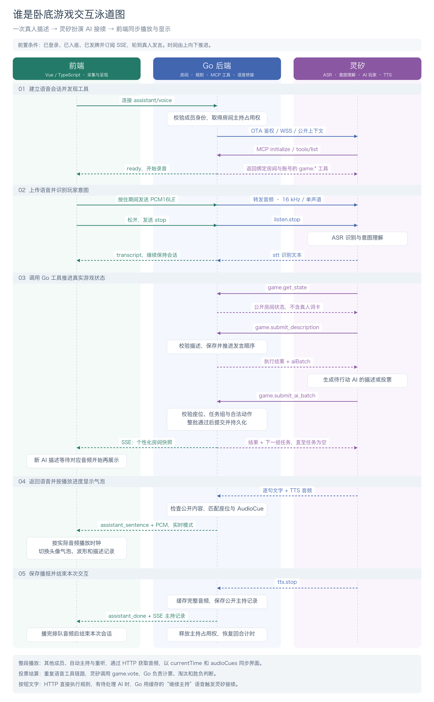

# 谁是卧底应用架构

当前应用由 Vue 和 TypeScript 前端、Go 后端、灵矽智能体三部分协作完成。**前端负责交互和声音呈现，Go 保存真实游戏状态并执行规则，灵矽负责听懂玩家、扮演 AI 玩家和生成语音。** 灵矽通过调用 Go 提供的游戏工具执行操作；发牌、投票和胜负以 Go 的执行结果为准。

本文对应已接入灵矽的正式游戏模式。未配置灵矽时，应用使用页面标识的本地演示策略。前端经 Vite 构建后通过 `go:embed` 嵌入 Go 服务，浏览器从同一个应用域名加载页面和访问 API。

## 三方职责

| 组件 | 负责的事情 | 保存或处理的数据 |
| --- | --- | --- |
| 前端 | 展示大厅、圆桌和词卡；采集麦克风；提交按钮或文字操作；接收房间事件；播放音频并同步头像气泡 | 当前账号可见的房间快照、自己的词、播放队列和播放进度 |
| Go 后端 | XBuilder 登录和会话；房间与座位；随机发牌；发言顺序、计票、淘汰及胜负；提供 MCP 工具；转发语音并缓存音频 | 完整对局、全部词卡与身份、会话哈希、公开发言记录、内存音频 |
| 灵矽 | 语音识别；理解“开始游戏”“我的描述”“我投二号”等意图；调用游戏工具；生成 AI 描述与投票；主持和语音合成 | Go 提供的房间上下文、AI 任务、当前语音会话上下文 |

XBuilder 是登录依赖。浏览器经授权流程登录，Go 完成令牌交换并建立 Redis 会话；游戏请求携带应用会话 Cookie。灵矽设备 Token、XBuilder Client Secret 都保留在 Go 服务端。

## 一次语音交互的泳道图

以下以四人局中“一名真人完成描述，三位 AI 接续发言”为例。前置条件是玩家已经登录、入座并完成发牌，当前轮到真人发言。图中时间从上往下推进，三列分别对应前端、Go 后端和灵矽。



同一流程的可编辑 [Mermaid 描述](diagrams/game-interaction.mmd) 和 [SVG 矢量图](diagrams/game-interaction.svg) 可用于继续修改或放入演示材料。

### 建立会话与上传语音

前端先通过 `GET /api/rooms/{id}/events` 建立长期 SSE 订阅。SSE 是后端向浏览器推送房间状态的通道，各成员收到自己的房间视图，`myWord` 只包含自己的词。

玩家按住中央按钮后，前端连接 `/api/rooms/{id}/assistant/voice`。Go 校验登录和房间成员身份，取得该房间的主持占用权，将 `agentActive` 设为 `true`，在处理期间暂停对应回合的超时推进。

Go 以已绑定的软件终端身份接入灵矽。默认先通过 OTA 获取终端 Token 与连接地址，再建立服务端 WSS 连接，发送公开房间上下文和主持约束。灵矽通过 MCP 的 `initialize`、`tools/list` 发现 Go 提供的游戏工具。

Go 返回 `ready` 后，前端录音并上传 16 kHz、单声道 PCM16LE，通常每 20 ms 发送 640 字节。Go 将音频转发给灵矽。玩家松开按钮，前端发送 `stop`，Go 再向灵矽发送 `listen.stop`。灵矽返回识别文本时，Go 转为 `transcript` 发给前端；此时对话继续，尚未结束。

### 灵矽调用工具推进游戏

灵矽先读取 `game.get_state`，结合玩家的话判断意图。对于描述，它调用 `game.submit_description`。Go 检查是否轮到当前账号发言、描述长度是否合法、是否直接包含自己的词，然后保存公开描述并推进发言顺序。

如果接下来轮到 AI，工具结果会带上 `aiBatch`：其中包括待行动 AI 的座位、各自词语、公开描述，以及投票时的合法候选人。灵矽为这组任务生成描述或投票，再调用 `game.submit_ai_batch` 提交。

Go 在游戏副本上校验整批操作。只有数量、顺序、座位和动作均合法，才提交整批状态，避免前两个 AI 成功而最后一个失败造成部分落库。任务组 ID 绑定当前对局进度，过期任务会被拒绝。返回结果若仍有新的 `aiBatch`，灵矽继续处理；没有任务时等待真人。AI 投票任务要等所有存活真人投完后才会发出。

每次成功改变游戏状态，Go 都会更新版本、持久化对局并推送 SSE。**因此，服务端可能已经完成三位 AI 的描述，而浏览器仍在播放第一位 AI 的声音。** 前端把“已提交的游戏状态”和“正在听到的发言”分别处理。

### 返回声音并同步界面

灵矽按已提交的 AI 描述生成主播播报，逐句返回文字和 TTS 音频。Go 检查公开回复是否包含尚未揭晓的词语，将句子与公开发言关联，记录其座位、发言 ID 和音频偏移。

当前会话的发起者在 PCM 模式下，接收 `assistant_sentence` 与后续二进制音频，使用 Web Audio 边接收边播放。前端按实际排定的播放时间切换头像气泡、声音波形和高亮；开启播报时，新 AI 描述也跟随播放逐条展示。

收到灵矽的 `tts.stop` 后，Go 将完整音频封装为 WAV 或 Ogg，缓存并保存 `source: "linx_agent"` 的公开主持记录，向发起者发送 `assistant_done`。Go 释放主持占用权，恢复回合计时；前端继续播放已经排队的声音，播放完才关闭本次语音上下文。

其他房间成员、非实时音频模式以及重听，通过 SSE 中的记录 ID 请求 `GET /api/rooms/{id}/audio/{event}`，播放完整音频。自动主持会话也采用这种整段音频播放方式。

## 开局与投票入口

同一个规则引擎处理语音工具和网页按钮。正式游戏的开局与再次开局通过语音发起；文字描述、点击投票仍保留直接操作入口。未配置灵矽的体验模式提供开局按钮。

| 玩家操作 | 入口与灵矽行为 | Go 的执行结果 |
| --- | --- | --- |
| 说“开始游戏” | 灵矽理解意图，调用 `game.start` | 校验房主；补齐 AI 座位；随机分配词和卧底；发牌后进入描述阶段 |
| 体验模式点击“开始体验” | 未配置灵矽时，前端请求 `POST /start` | 执行开局规则，SSE 同步词卡与阶段；AI 使用本地演示策略 |
| 按住描述自己的词 | 灵矽调用 `game.submit_description` | 保存描述，推进下一位，返回待处理 AI 任务 |
| 输入文字并确认 | 前端直接请求 `POST /speech` | 保存描述；有待处理 AI 时由后台调度灵矽接续 |
| 说“我投二号” | 灵矽调用 `game.vote` | 校验阶段、身份、是否已投和合法目标；票齐后统一计票 |
| 点击玩家后确认投票 | 前端直接请求 `POST /vote` | 执行同一套投票规则；需要 AI 投票时调度灵矽 |
| 说“跳过”或点击跳过 | `game.skip` 或 `POST /skip` | 跳过自己的发言，不伪造一条玩家描述 |

表中的 HTTP 路径省略了 `/api/rooms/{id}` 前缀。票齐后，Go 决定淘汰、平票加赛、进入下一轮或结束。结束时，房间视图才包含所有人的 `reveals`，前端翻开桌面词卡并展示胜负；灵矽根据规则执行结果播报。

### 没有麦克风输入时如何触发 AI

按钮或文字操作成功后，Go 每 500 ms 检查待处理的 AI 任务。需要 AI 行动时，后台取得房间主持占用权，用缓存的“继续主持”语音进入同一套灵矽语音和 MCP 会话。该短音频首次由灵矽合成，转换为 16 kHz PCM 后供后续调用复用。

因此，当前自动接续也使用绑定的灵矽智能体，**不读取 `LLM_BASE_URL`、`LLM_API_KEY` 或 `LLM_MODEL`**。Go 负责触发时机与工具执行，AI 内容仍由灵矽生成。有真人正在发言、或正在等待真人投票时，不会提前生成对应 AI 任务。

## 通信与语音同步

| 通道 | 方向 | 承载内容 |
| --- | --- | --- |
| HTTP JSON | 前端与 Go | 登录状态、大厅、入座、开始、文字发言、点击投票 |
| SSE | Go → 前端 | 个性化 `RoomView`、阶段、公开记录、`agentActive`、状态版本 |
| 浏览器 WebSocket | 前端 ↔ Go | 本次麦克风 PCM、停止指令、识别文本、实时回复音频与控制消息 |
| 服务端 WSS | Go ↔ 灵矽 | 设备语音协议、提示词上下文、MCP JSON-RPC、ASR 与 TTS |
| HTTP 音频 | Go → 前端 | 公开录音、缓存的灵矽原声，或按公开记录重新合成的音频 |

MCP 工具调用与语音共用 Go 到灵矽的 WSS 连接。当前 Go 应用直接实现端侧 MCP 协议，没有单独部署一个公网 MCP 服务。前端也不直接连接灵矽。

完整音频的 `audioCues` 保存逐句播放标记，例如：

```json
{
  "offsetMs": 3200,
  "text": "它在生活里经常出现。",
  "logId": "speech-example",
  "playerId": "player-example",
  "seat": 2
}
```

实时 PCM 播放按 `AudioContext.currentTime` 与音频调度时间触发标记；整段音频按媒体的 `currentTime` 和 `offsetMs` 选择当前句。网络收到下一句文字，不会立即切换头像气泡。前端也会去重已实时听过的主持记录，避免 SSE 到达后再播一次。

这保证的是单个浏览器内的文字与声音同步。不同成员的网络、自动播放权限和播放进度可能不同，目前没有统一的跨客户端播放时钟。音频缓存丢失后重新合成的声音，逐句时长也可能与原始标记不同。

## 状态管理与异常处理

Go 的房间管理器和规则引擎保存完整状态；浏览器和灵矽都通过受限接口访问。PostgreSQL 的 `undercover_rooms.state` JSONB 持久化每间房间的完整状态，Go 通过 pq 驱动按房间写入；Redis 保存以随机 Token 哈希为键的用户会话并设置七天 TTL。应用不再读写 `data` 目录。音频、SSE 订阅和计时器仍保留在内存，部署方式为单实例，PostgreSQL advisory lock 阻止同一 schema 同时运行两个游戏进程。

房主确认关闭后，Go 先删除 PostgreSQL 记录，成功后清除内存状态、取消正在进行的语音与 AI 处理，并发送 `closed` SSE。所有成员停止播放并回到大厅；大厅后续刷新不再显示该房间。删除或写入失败时保留原状态，避免界面显示成功而数据库未保存。空数据库不会自动生成演示房间，关闭后的房间不会在重启时重新出现。

- **词卡隔离**：结束前，成员视图只返回自己的词。主持公开上下文去掉真人词卡，AI 任务单独把待行动 AI 的词交给灵矽。公开主播播报若命中尚未揭晓的完整词语，会被替换为安全提醒。
- **AI 角色边界**：同一个灵矽主持会话扮演多个 AI；一个任务组可能包含多位 AI 的词。当前没有为每位 AI 建立独立模型上下文，不能把提示词中的角色约束理解为严格的信息隔离。
- **操作校验**：工具绑定当前登录账号与房间，拒绝越权、乱序和非法投票。同一语音会话内缓存相同 MCP 请求的结果，避免传输重试重复执行；这不是跨连接的全局幂等机制。
- **会话占用**：同一房间只允许一个主持会话，处理期间暂停回合超时。单个软件终端同时只承载一条上游语音连接，多个房间并行需要足够的终端身份。
- **云端失败**：仍待处理的 AI 回合会退避重试；已经通过校验提交的操作保留。若最终回复中断，前端可对尚未播报的公开 AI 描述逐位补播。配置了灵矽时，不会悄悄切到本地演示机器人生成 AI 行动。
- **播放失败**：浏览器阻止自动播放时保留队列并提示点击开启声音；灵矽音频获取失败时尝试浏览器语音并显示来源。历史房间恢复后不自动重播整局。

## 代码入口

| 位置 | 对应职责 |
| --- | --- |
| [App.vue](../web/src/App.vue) | 房间订阅、圆桌词卡、AI 描述展示、头像气泡与动作入口 |
| [usePushToTalk.ts](../web/src/composables/usePushToTalk.ts) | 麦克风采集、完整语音会话、实时 PCM 排队与播放时钟 |
| [useNarration.ts](../web/src/composables/useNarration.ts) | 整段播报、重听、自动播放恢复及备用语音 |
| [conversation.go](../internal/server/conversation.go) | 浏览器与灵矽语音桥接、公开回复检查、音频与播放标记 |
| [game_tools.go](../internal/server/game_tools.go) | 工具定义、主持约束、当前账号与房间绑定 |
| [agent_driver.go](../internal/server/agent_driver.go) | 按钮和文字操作后的灵矽自动接续 |
| [postgres.go](../internal/storage/postgres.go) | 房间持久化、硬删除、单实例占用与旧数据导入 |
| [redis.go](../internal/storage/redis.go) | Session 保存、TTL、查询与撤销 |
| [mcp.go](../internal/linx/mcp.go) | 同一 WSS 上的 MCP 发现、调用和会话内请求去重 |
| [engine.go](../internal/game/engine.go) 和 [agent.go](../internal/game/agent.go) | 权威规则、AI 任务组、原子提交与主持占用 |
| [API 文档](api.md) | HTTP、SSE、浏览器 WebSocket 消息和音频标记格式 |
