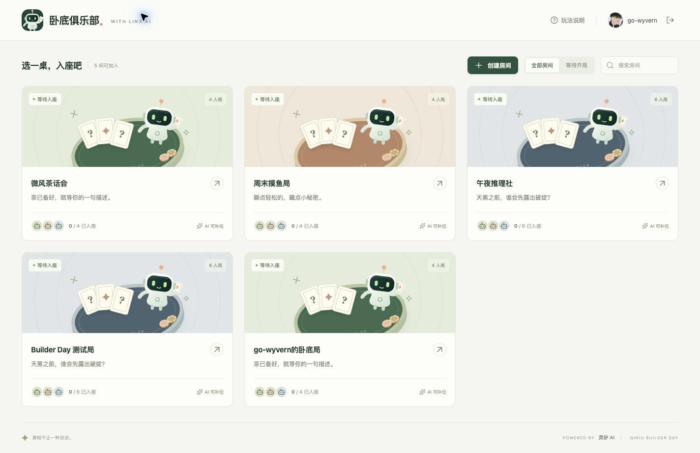
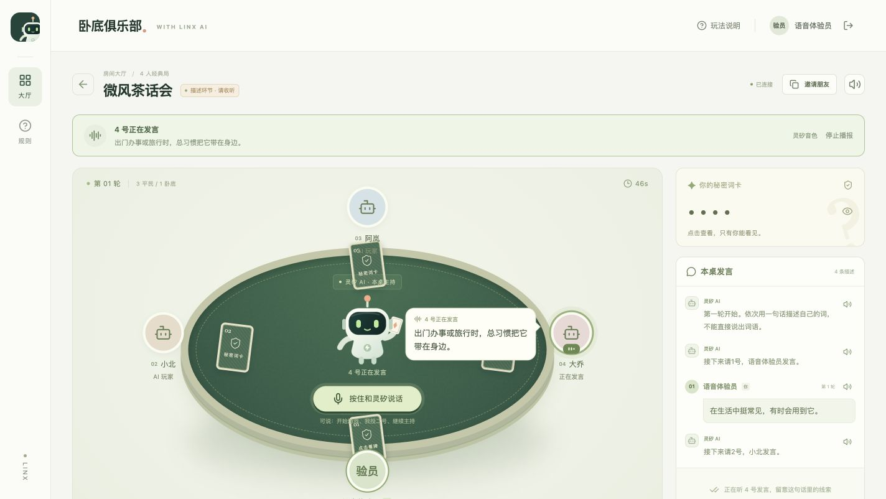

# 灵矽卧底俱乐部产品设计

灵矽卧底俱乐部是一款由灵矽主持、支持真人与 AI 同桌的网页语音游戏。玩家打开浏览器，选一张桌子，拿到自己的词卡，再通过描述和投票寻找卧底。一个人也能开局，朋友加入后可以一起玩，空位由 AI 补齐。

产品的核心思路是：**保留灵矽自然对话和 AI 陪玩的能力，用交互页面承接座位、词卡、发言和投票，让玩家把注意力放在推理上。**

## 为什么需要一个游戏页面

在本次灵矽控制台原型中，玩家已经可以与 AI 玩家完成一局谁是卧底。语音能够表达游戏规则、角色发言和投票意图，但谁是卧底还需要一组持续可见的信息：谁坐在哪里、谁刚刚说过什么、自己的词是什么、当前轮到谁，以及自己的票是否已经生效。

这些信息主要依靠对话传达时，玩家需要一边听内容，一边在脑中维护整张桌子的状态。人数和轮次增加后，容易出现以下体验问题：

| 玩家遇到的情况 | 对游戏体验的影响 | 页面如何改善 |
| --- | --- | --- |
| 多位 AI 由同一个主持依次转述 | 听得到内容，但难形成“几个人坐在一起玩”的感觉 | 固定座位、头像、名字和桌面词卡，让每位玩家有稳定的位置 |
| 忘了某位玩家前一轮的描述 | 需要反复询问主持或翻找对话，打断判断 | 按玩家和轮次保留公开发言，每条都能重听 |
| 不确定当前轮到谁 | 玩家需要询问进度，可能在错误阶段发言或投票 | 页面显示阶段、轮次、等待对象与可执行操作 |
| 需要在同一对话中处理自己的词与公开发言 | 玩家需要额外留意哪些内容可以说、哪些只能自己看 | 自己的词在私密区域查看，其他人的词卡保持背面 |
| 说出投票意图后，不确定是否已经记上 | 玩家可能重复投票，或对结果产生疑问 | 提交后显示已投状态，票齐后统一展示结果 |

这里的改进针对本次控制台游戏原型的使用体验。灵矽已经提供了完整陪玩所需的对话能力，专门的页面进一步补齐多人游戏需要的空间感、信息回看和操作反馈。

## 产品定位与目标

产品面向想随时玩一局轻推理游戏的人，也适合朋友聚会、开发者活动和黑客松现场体验。四人局用于轻松开场，六人局提供更多描述线索。玩家通过浏览器参与，无需额外硬件。

设计希望达到三个目标：

1. **容易开始**：登录后可以直接找桌入座，人不齐也能玩。
2. **容易跟上**：不用反复询问“谁在说话”“现在该做什么”，页面持续给出答案。
3. **有一起玩的感觉**：每位玩家都有座位、词卡和发言表现，灵矽主持把大家组织成一桌。

本版围绕经典谁是卧底规则形成完整体验，包含开局、描述、投票、平票加赛、淘汰和结算。后续是否增加更多玩法，应以这条体验是否顺畅为前提。

## 一局游戏的用户旅程

| 阶段 | 玩家做什么 | 页面与灵矽如何回应 |
| --- | --- | --- |
| 登录与选房 | 使用 XBuilder 登录，选择现有房间或创建房间 | 展示可加入的桌子、人数、状态和 AI 补位提示 |
| 入座与邀请 | 看到自己的座位，按需复制房间链接邀请朋友 | 固定座号，标出“你”和房主，空位提示可由 AI 补齐 |
| 开局与看牌 | 房主按住中央按钮，对灵矽说“开始游戏” | 灵矽主持开场，页面展示发牌过程，自己的词卡可点击查看 |
| 轮流描述 | 轮到自己时按住说话，或输入文字后确认 | 语音由灵矽理解并提交；AI 接续发言，页面按声音显示对应头像气泡 |
| 判断与投票 | 回看线索，选择最可疑的玩家，或说“我投二号” | 页面反馈投票状态；票齐后统一计票，主持播报结果 |
| 继续或加赛 | 根据提示补充描述或再次投票 | 页面标明新一轮或平票候选人，仅开放当前合法的操作 |
| 揭晓与再来 | 查看所有人的词与阵营，重听关键描述 | 展示胜负与词卡，房主可以直接再开一局 |

这条旅程同时支持“一个真人加多位 AI”和“多个真人加 AI 补位”。朋友需要在开局前加入；正在游戏中的房间不开放中途入座。

## 页面与交互设计

### 房间大厅

大厅首先回答“我现在可以去哪里玩”。房间以桌卡呈现，展示房间名、四人或六人规格、已入座人数、是否正在游戏，以及 AI 能否补位。玩家可以搜索房间、筛选等待开局的房间。大厅直接呈现房间列表；机器人标识、玩法说明和账号入口集中在顶部导航，“创建房间”与筛选放在同一行。

创建房间只需要选择房间名、人数和氛围主题。模型、提示词和设备配置留在部署与管理环节，普通玩家无需填写 API Key。玩法说明用收词卡、轮流描述、投票和揭晓四步帮助新玩家入门。

*大厅界面示例。登录入口和体验模式标识随实际部署配置变化。*

房主可以在圆桌右上角关闭房间。确认提示说明会删除房间与本局记录，所有同桌玩家返回大厅；普通成员只提供离席操作。关闭成功后大厅不再展示该房间。

### 圆桌布局

圆桌是对局的主要场景，页面围绕玩家的三个关注点组织：

| 区域 | 展示内容 | 解决的问题 |
| --- | --- | --- |
| 中央主持区 | 灵矽机器人、主持提示、按住说话按钮 | 始终知道主持在哪里，以及如何参与 |
| 桌边座位区 | 固定座号、玩家名、AI 标识、词卡、当前发言气泡、已投票或出局状态 | 把声音对应到具体的人，形成同桌感 |
| 信息与操作区 | 自己的秘密词卡、公开发言记录、文字输入或投票选项 | 随时看牌、回看线索，并完成当前操作 |

页面顶部保留语音状态栏，说明当前正在准备声音、正在播报还是等待玩家；桌面同时显示轮次、游戏阶段和行动提示。计时用于提示当前回合的剩余时间。

中央的灵矽机器人承担主持角色，桌边的 AI 头像承担玩家角色。即使底层由同一个灵矽智能体扮演多位 AI，视觉上也能清楚区分“主持在推进流程”和“某号玩家在描述”。

### 发牌与秘密词卡

房主对灵矽说“开始游戏”后，灵矽执行开局，空位补为 AI，页面播放发牌动画。动画结束后，每位玩家面前都有一张常驻词卡，持续传达“大家已经拿到牌，游戏正在进行”。

自己的词卡默认遮住，点击桌面上的卡或侧边私密区域都可以查看，再次点击收起。对手的卡在对局中始终保持背面。**玩家只知道自己的词，开局时也不知道自己属于平民还是卧底。** 被淘汰玩家的阵营随结果播报，完整词卡和阵营在结算时统一展示。

发牌的视觉反馈与实际词卡状态相对应。玩家可以直接确认自己已经拿到词，无需依靠主持一句“发牌完成”来猜测操作是否生效。

### 发言与同步气泡

语音是主要表达方式。玩家按住中央按钮录音，松开后由灵矽理解内容并执行相应操作。录音时显示“正在说话”，松开后进入识别与处理状态；这个入口不再要求玩家额外点击文字确认。

不方便说话时，玩家可以在右侧输入描述，再点击“确认发言”。两种入口都进入同一局游戏，不需要切换模式或重新开局。

AI 发言采用以下表现：

- 声音播到某位玩家时，对应头像高亮并显示波形。
- 文字气泡贴近该玩家头像，标出座号和当前描述。
- 新 AI 描述跟随播报进入右侧记录，后面的 AI 描述不会提前整批展示。
- 声音切换到下一位时，气泡和高亮随之切换。

这里最关键的是**以玩家实际听到的内容为准**。如果页面已经出现四号的发言，声音却还在播放二号，玩家会提前读完后面的内容，也容易把线索记到错误的人身上。声音、气泡和发言记录围绕同一位玩家同步，才能保留轮流发言的节奏。

页面分别表达“下一位轮到谁”和“此刻正在听谁”。AI 已完成生成但声音尚未开始时，显示准备或等待播报；听完 AI 描述后，再引导真人投票。

*发言效果示例：四号的声音、头像高亮与文字气泡对应，其他人的词卡保持背面。*

当前多位 AI 共用控制台配置的灵矽音色，通过固定座位、名字和气泡区分角色。每位 AI 使用不同音色属于后续改进方向。

### 线索回看与投票

公开发言按座号、名字和轮次保留，玩家可以在自己的回合前或投票前回看。每条记录提供重听入口，便于比较“这一轮和上一轮的说法是否一致”。

进入投票阶段后，玩家可以点击桌边头像，或在右侧候选列表中选择目标。被选中的玩家会高亮，按钮明确显示“确认投给二号”，点击确认才提交，降低误触。页面也提供弃权入口。

语音投票使用明确指令，例如“我投二号”，灵矽理解后直接提交。它与点击投票的确认方式不同：点击通过选择与确认表达意图，语音通过完整的投票指令表达意图，提交后都要有清晰的状态反馈。

只有合法对象可以被选择，不能投自己或已出局玩家；平票加投时只开放平票候选人。玩家提交后显示已投状态，具体票型在票齐后统一揭晓。投票结果、淘汰与下一阶段由规则决定，灵矽根据结果播报。

### 结算与再来一局

游戏结束后，桌面词卡全部翻开，结果区展示每位玩家的词与阵营，并说明哪个阵营获胜。玩家仍可回看和重听本局描述，核对之前的判断。

结算区提示房主按住圆桌中央按钮说“再来一局”。重新发牌后收起上一局的秘密信息，回到新一局的描述流程。正式游戏的开局和再次开局都通过语音发起，页面提供状态和说法提示。

未绑定灵矽时，体验模式保留“开始体验”和“再玩一局”的按钮，供部署前试玩本地流程。

## 反馈与异常体验

| 状态 | 玩家看到或能够做的事情 | 设计目的 |
| --- | --- | --- |
| 不是自己的回合 | 显示等待哪位玩家，保留查看与重听入口 | 等待期间仍能观察线索 |
| 灵矽正在处理 | 显示正在理解或组织 AI 回合的状态，避免重复开启语音 | 让玩家知道请求已收到 |
| 声音尚未准备好 | 显示准备语音，气泡不抢先切到后面的玩家 | 保持文字和声音的顺序一致 |
| 浏览器阻止自动播放 | 提示“点击开启声音”，保留待播内容 | 给出明确的恢复动作 |
| 麦克风不可用 | 提示原因，在对应回合继续使用文字或点击投票 | 不让单一输入方式阻断整局 |
| 音频播放失败 | 提供重试和重听；切换浏览器语音时标明来源 | 让玩家知道当前收听状态 |
| 网络重连 | 显示重连状态，恢复当前房间进度 | 避免玩家误以为需要重新开局 |
| 玩家出局 | 头像弱化，标明观战状态 | 保留同桌感，同时区分可行动玩家 |
| 游戏中离席 | 先确认离席，说明座位会由 AI 接续 | 让离开对其他玩家的影响可预期 |

声音开关改变收听方式，已经提交的发言和投票仍保留。关闭播报时，玩家可以通过文字继续游戏；开启声音后也可以手动重听记录。

## 灵矽在产品中的角色

灵矽持续提供这款产品的主要 AI 能力：听懂自然语言、识别玩家意图、扮演空位 AI、生成描述和投票，并通过语音完成主持。玩家依然可以直接与灵矽交谈。

交互页面让这些能力产生看得见的结果：说“开始游戏”后词卡发到桌上，说完描述后记录进入对应座位，说“我投二号”后出现已投状态。Go 后端保存房间、词卡和票数，校验操作并决定轮次与胜负，保证页面上的对局状态一致。技术协作过程见 [架构文档](architecture.md)。

## 本版范围与后续验证

本版已经包含房间大厅、XBuilder 登录、四人和六人局、AI 补位、圆桌词卡、语音与文字操作、同步发言气泡、投票加赛、结算和本局发言重听。

后续优先考虑多位 AI 的独立音色与角色表现、移动端按住说话的易用性，以及多人客户端之间更一致的播放节奏。排行榜、观战大厅、完整历史战绩和社交分享可在核心对局体验稳定后再扩展。

“页面会让体验更好”需要通过试玩验证。建议让新玩家分别体验控制台原型和网页版本，交叉安排先后顺序，重点观察：

| 观察项 | 要验证的问题 |
| --- | --- |
| 首局完成情况 | 玩家能否在没有开发者口头指导的情况下完成一局 |
| 进度询问次数 | 是否减少“轮到谁”“现在能投了吗”一类问题 |
| 发言归属判断 | 玩家能否准确记住某条描述是谁说的 |
| 投票操作情况 | 是否减少误选、重复提交和对投票是否生效的疑问 |
| 主观参与感 | 玩家是否更容易感到自己正与几位玩家围桌游戏 |
